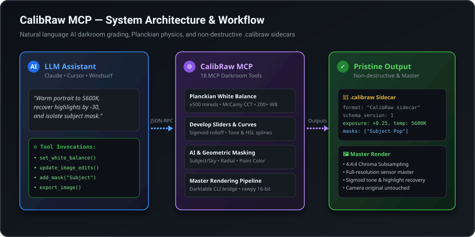

# CalibRaw MCP

[](LICENSE)
[](https://python.org)
[](https://modelcontextprotocol.io)
[](https://github.com/psf/black)

A professional **Model Context Protocol (MCP)** server that connects Large Language Models (Claude Desktop, Cursor, Antigravity, Windsurf) to professional **RAW camera digital darkrooms**.

It enables AI assistants to inspect camera metadata, manipulate non-destructive **`.calibraw` JSON sidecars**, apply physical **Planckian white balance math**, create **local AI/geometric masks**, tune targeted **point colors**, and render **full-fidelity 4:4:4 master images** from camera RAW files (`.CR3`, `.NEF`, `.ARW`, `.DNG`, etc.).

<p align="center">
  
</p>

---

## 🌟 Key Capabilities

* **Non-Destructive `.calibraw` Sidecars (Schema v1)**: Clean, human-readable and LLM-friendly JSON sidecars completely decoupled from messy binary or proprietary XML files. Your original RAW files are never modified.
* **Physical White Balance Engine**: Real Planckian blackbody locus calculations, accurate Kelvin-to-mired offsets ($\pm 500$ mireds, $\pm 219$ tint), McCamy CCT estimation from camera color matrices, and 200+ camera illuminant presets (Daylight, Cloudy, Shade, Tungsten, Fluorescent, Flash).
* **High-Precision Develop Sliders**: Perceptual Lightroom-style sliders (Exposure, Contrast, Highlights, Shadows, Whites, Blacks, Clarity, Dehaze, Texture, Vibrance, Saturation, Sharpening, Vignette, Chromatic Aberration).
* **Film Tone Curves & Sigmoid Mapping**: Custom parametric spline curves (RGB and individual R/G/B channels) and physical Sigmoid display mapping with configurable slope, toe, and shoulder rolloff.
* **Local Masking System**: Radial gradients, Linear gradients, Brush masks, Luminance/Color range qualifiers, and on-device AI masks (`Subject`, `Background`, `Sky`) with independent exposure, contrast, temperature, tint, and color grading.
* **Targeted Point Color & Creative Effects**: 8-point targeted color sampling (Hue/Saturation/Luminance shifts with range qualifier bounds) and creative atmospheric components (Fog, Smoke, Light Rays, Glow, Neon, Halation, Analog Grain).
* **Native Preset Standard (`.calibraw-preset`)**: Native file format with selective category masking (`AdjustmentGroupSet`) for non-destructive grading exchange and batch propagation across photo sessions.
* **Dual Master Export Engine**:
  1. **Scene-Referred Bridge**: Auto-discovers and drives `darktable-cli` for physical sensor demosaicing when installed.
  2. **Standalone Calibrated Pipeline**: Built-in 16-bit `rawpy` pipeline with Planckian white balance, highlight/shadow recovery, Sigmoid display mapping, and high-fidelity 4:4:4 chroma subsampling (Quality 96).

---

## 🚀 Quick Start

### Installation

Install directly from GitHub via pip:

```bash
pip install git+https://github.com/tej554/calibraw-mcp.git
```

Or run directly without installation using `uvx`:

```bash
uvx --from git+https://github.com/tej554/calibraw-mcp.git calibraw-mcp
```

Or install from source:

```bash
git clone https://github.com/tej554/calibraw-mcp.git
cd calibraw-mcp
pip install -e .
```

---

## ⚙️ MCP Client Configuration

### Claude Desktop

Add `calibraw-mcp` to your `claude_desktop_config.json` (`%APPDATA%\Claude\claude_desktop_config.json` on Windows or `~/Library/Application Support/Claude/claude_desktop_config.json` on macOS):

```json
{
  "mcpServers": {
    "calibraw": {
      "command": "uvx",
      "args": ["--from", "git+https://github.com/tej554/calibraw-mcp.git", "calibraw-mcp"]
    }
  }
}
```

Or using an existing Python environment:

```json
{
  "mcpServers": {
    "calibraw": {
      "command": "python",
      "args": ["-m", "calibraw_mcp.server"],
      "env": {
        "CALIBRAW_PHOTOS_DIR": "/path/to/your/photos"
      }
    }
  }
}
```

### Cursor / Antigravity / Windsurf

Add to your project's `.cursor/mcp.json` or `.mcp.json`:

```json
{
  "mcpServers": {
    "calibraw": {
      "command": "python",
      "args": ["-m", "calibraw_mcp.server"]
    }
  }
}
```

---

## 🛠️ MCP Tool Reference (18 Tools)

### 1. Sidecar & Develop Sliders
| Tool | Description |
| :--- | :--- |
| **`read_image_edits(image_path)`** | Inspect active adjustments, Sigmoid parameters, tone curves, color grading wheels, and review metadata. |
| **`update_image_edits(image_path, adjustments)`** | Apply or tweak perceptual sliders (exposure, highlights, shadows, whites, blacks, temperature, tint, vibrance, saturation, clarity, dehaze, texture, curves, HSL). |
| **`reset_image_edits(image_path)`** | Revert sidecar to neutral scene-referred defaults. |
| **`get_sidecar_json(image_path)`** | Retrieve raw `.calibraw` JSON document string. |

### 2. EXIF & Physical White Balance
| Tool | Description |
| :--- | :--- |
| **`get_image_info(image_path)`** | Extract camera make/model, lens, ISO, shutter speed, aperture, focal length, CFA sensor layout, and preview dimensions. |
| **`set_white_balance(image_path, kelvin, tint, preset)`** | Set white balance using absolute Kelvin (2000K–12000K), mired offsets, or camera illuminant presets (`Daylight`, `Cloudy`, `Shade`, `Tungsten`, `Fluorescent`, `Flash`). |

### 3. Local Masks & Selective Adjustments
| Tool | Description |
| :--- | :--- |
| **`add_mask(image_path, mask_type, name, adjustments, ...)`** | Create local masks (`Radial`, `Linear`, `Brush`, `Subject`, `Background`, `Sky`, `ColorRange`, `LuminanceRange`) with independent exposure, contrast, temperature, and tint. |
| **`list_masks(image_path)`** | List all active local masks, their types, bounding geometry, and adjustments. |
| **`remove_mask(image_path, mask_id)`** | Delete a local mask by ID or name. |

### 4. Point Color & Creative Effects
| Tool | Description |
| :--- | :--- |
| **`add_point_color(image_path, source_hue, target_hue, ...)`** | Sample and selectively shift specific colors with targeted Hue, Saturation, and Luminance delta offsets. |
| **`add_global_effect(image_path, effect_type, params)`** | Apply cinematic effects: `Fog`, `Smoke`, `LightRays`, `Glow`, `Neon`, `Halation`, `Grain`, `LensBlur`. |

### 5. Presets & Grading Transfer
| Tool | Description |
| :--- | :--- |
| **`apply_preset(image_path, preset_name)`** | Apply built-in film emulations: `Kodak Portra 400`, `Golden Hour Warmth`, `Dramatic Sky Recovery`, `Moody Teal & Orange`, `Clean Portrait CAT16`, `Monochrome Fine Art`. |
| **`list_presets()`** | Catalog all available built-in film emulations. |
| **`apply_native_preset(image_path, preset_path)`** | Load and apply a native `.calibraw-preset` file with selective category masking. |
| **`export_native_preset(image_path, preset_name, ...)`** | Export active adjustments to a portable `.calibraw-preset` file. |
| **`list_native_presets(directory)`** | Scan directories (`%APPDATA%/calibraw/presets`, `~/.config/calibraw/presets`, etc.) for installed native presets. |
| **`copy_settings(source_image, target_images, categories, mode)`** | Selectively copy adjustments (Basic, Curves, HSL, ColorGrading, Masks, Geometry) across single or batch photo lists. |

### 6. Master Image Rendering
| Tool | Description |
| :--- | :--- |
| **`export_image(image_path, output_path, format, quality, ...)`** | Renders full-fidelity master images applying all active `.calibraw` edits. Outputs pristine 4:4:4 JPEGs (Quality 1-100), lossless PNGs, or 16-bit TIFFs. |

---

## 💬 Conversational Prompt Examples

Once registered with your AI assistant, you can grade RAW photos conversationally using natural language across diverse photographic styles:

### 1. Optical Ingest & Shot Inspection
> **User**: *"Inspect `golden_hour.arw`, read its sensor metadata, and summarize the shot configuration."*
>
> **Assistant**: Calls `get_image_info(image_path="golden_hour.arw")` and returns:
> ```json
> {
>   "camera_make": "Sony",
>   "camera_model": "ILCE-7M4",
>   "lens": "FE 24-70mm F2.8 GM II",
>   "iso": 100,
>   "shutter_speed": "1/250s",
>   "aperture": "f/2.8",
>   "focal_length": "50.0 mm",
>   "cfa_pattern": "RGGB",
>   "sensor_dimensions": [7008, 4672]
> }
> ```

### 2. Physical White Balance & Atmosphere
> **User**: *"The lighting in `mountain_landscape.nef` feels too cool. Warm it up to 5800K, correct green tint to +8, and open the shadows by +20."*
>
> **Assistant**: Calls `set_white_balance(image_path="mountain_landscape.nef", kelvin=5800, tint=8)` to compute Planckian blackbody locus mired offsets, then calls `update_image_edits(image_path="mountain_landscape.nef", adjustments={"shadows": 20.0})`.

### 3. AI Masking & Subject Isolation
> **User**: *"Create an AI subject mask on `portrait.cr3`. Increase the subject's exposure by +0.35 EV, slightly soften skin tones, and cool the background."*
>
> **Assistant**: Calls `add_mask(image_path="portrait.cr3", mask_type="Subject", name="Model Pop", adjustments={"exposure": 0.35, "temperature": 30.0})`, followed by an inverted mask for background color balance.

### 4. Cinematic Emulation & Batch Sync
> **User**: *"Apply the Kodak Portra 400 preset to `studio_session_01.dng`. Then copy only the color grading and tone curve to `studio_session_02.dng` and `studio_session_03.dng`, and render full-resolution JPEGs."*
>
> **Assistant**: 
> 1. Calls `apply_preset(image_path="studio_session_01.dng", preset_name="Kodak Portra 400")`
> 2. Calls `copy_settings(source_image="studio_session_01.dng", target_images=["studio_session_02.dng", "studio_session_03.dng"], categories=["Curves", "ColorGrading"], mode="merge")`
> 3. Calls `export_image(...)` across the set for pristine 4:4:4 JPEGs.

---

## 📄 Non-Destructive Sidecar Preview

Every adjustment applied by CalibRaw MCP is written to a clean, structured `<image_name>.calibraw` JSON file. Your camera original RAW file is never altered:

```json
{
  "format": "CalibRaw edit sidecar",
  "schema_version": 1,
  "basic": {
    "exposure": 0.35,
    "highlights": -30.0,
    "shadows": 20.0,
    "whites": 10.0,
    "blacks": -5.0,
    "temperature": 78,
    "tint": 10,
    "clarity": 15.0,
    "vibrance": 18.0
  },
  "sigmoid": {
    "slope": 1.45,
    "shoulder_lift": 0.05
  },
  "masks": [
    {
      "id": "mask-subj-1",
      "name": "Model Pop",
      "mask_type": "Subject",
      "adjustments": {
        "exposure": 0.35,
        "temperature": 30.0
      }
    }
  ]
}
```

---

## 🖥️ Client Compatibility & Demos

CalibRaw MCP is designed for seamless operation across major AI coding and conversational environments:

| Environment | Mode | Workflow |
| :--- | :--- | :--- |
| **Claude Desktop** | Conversational UI | Chat with your photos in natural language, view tool execution traces, and inspect sidecars. |
| **Cursor / Windsurf** | Agentic IDE | Ask agent to audit photos in workspace, run batch color grading, and generate master exports. |
| **Antigravity** | Autonomous Darkroom | Full integration with dual-engine preview, before/after splits, and sidecar inspection. |
| **CLI / Scripts** | Headless Automation | Script automated ingest pipelines, lens calibration, and mass preset applications. |

## 📂 Project Structure

```
calibraw-mcp/
├── pyproject.toml              # Build & packaging configuration
├── requirements.txt            # Package dependencies
├── LICENSE                     # MIT License
├── README.md                   # Documentation & tool reference
└── calibraw_mcp/
    ├── __init__.py             # Module exports
    ├── __main__.py             # CLI runner (`python -m calibraw_mcp`)
    ├── server.py               # FastMCP server & 18 tool handlers
    ├── sidecar.py              # CalibRaw Schema v1 JSON serialization
    ├── exporter.py             # Dual master rendering engine (Darktable CLI + rawpy)
    ├── masks.py                # Local masking, point colors & creative effects
    ├── metadata.py             # RAW sensor & EXIF parser
    ├── native_presets.py       # Native .calibraw-preset file encoder/decoder
    ├── presets.py              # Built-in photographic & film look emulations
    ├── transfer.py             # Selective settings transfer & batch processing
    ├── white_balance.py        # Planckian CCT calculations & mired math
    └── wb_presets.json         # Bundled camera white balance illuminant database
```

---

## 📜 License

This project is licensed under the [MIT License](LICENSE).

---

## 🙏 Acknowledgements

* [CalibRaw](https://github.com/Duecki1/CalibRaw) — The blazing fast, modern RAW photo editor and sidecar specification.
* [Darktable](https://www.darktable.org) — Scene-referred color science and camera demosaicing engine.
* [Model Context Protocol](https://modelcontextprotocol.io) — The open protocol for seamless LLM-tool connectivity.
